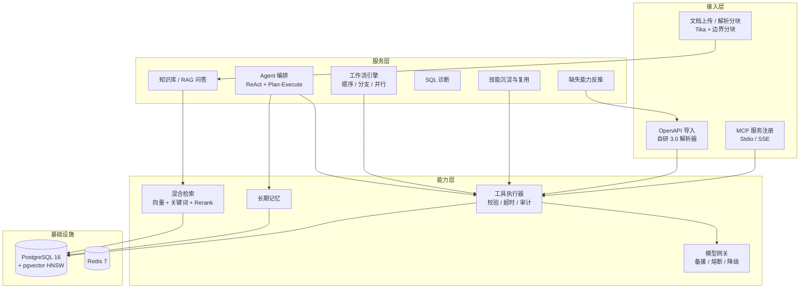
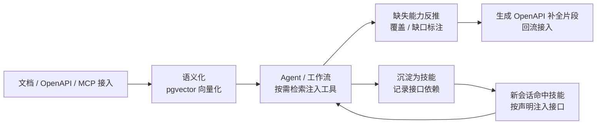

# DevMind

[](https://github.com/StartOver000/DevMind/actions/workflows/ci.yml)

**面向研发团队的通用 AI 接入层平台** —— 把文档、接口（OpenAPI）、MCP 服务统一「语义化」接入 AI：Agent 对话与工作流按需发现并调用工具，缺失能力自动反推补全，沉淀为可跨会话复用的技能。

> 核心思想：**接入即能力**。不为每个系统单独写 AI 集成 —— 上传文档 / 登记接口 / 注册 MCP 后，即可被 AI 检索、调用与复用。
>
> 定位澄清：它不是又一个低代码编排平台，而是研发团队自己的 AI 接入层——接口来源是团队真实的 OpenAPI 与 MCP；接入一次，对话、工作流、技能三种形态共享复用。

## 60 秒看懂：一条完整的接入闭环

以「让 AI 查订单并对账」为例，这是 DevMind 设计的主链路：

1. **接入** —— 把订单系统的 OpenAPI 导入（或注册一个 MCP 服务）：接口被解析成带语义描述的工具档案，向量化入库；
2. **调用** —— 对话里说「查一下最近三天金额超过一万的订单」：Agent 语义检索命中接口工具，生成参数并真实调用，全程留审计轨迹；
3. **反推缺口** —— 换成「把对账单也拉出来对一遍」：已接入的接口没有对账能力，系统标注覆盖与缺口，并生成缺失接口的 OpenAPI 补全片段回流接入（模型编造的接口会被白名单校验拦下）；
4. **沉淀技能** —— 这条「查订单 + 对账」路径存为技能，声明式记录它依赖哪些接口；
5. **稳定复用** —— 下一个会话命中该技能时，按声明直接注入接口，不再依赖语义检索的运气，结果可复现。

完整链路见下文「能力闭环」图；真实模型下的工具选择评测（8/8，含 Stripe 真实接口）见「质量证据」一节。

## 核心能力

| 能力 | 说明 |
| --- | --- |
| 知识库与 RAG 问答 | 文档上传解析（Tika）→ 分块 → 向量入库；混合检索（向量 0.9 + 关键词 0.1，实测 **KB19 MRR 1.0 / Recall 1.0**）+ 查询路由 + 双模式 Rerank（可回退）；多轮会话（查询改写）、引用溯源、版本对比回滚 |
| Agent 编排 | ReAct + Plan-Execute 双模式，工具调用校验/超时/审计，**统一输入防护（Prompt 注入检测）**，长期记忆（分层：核心常驻 + 场景按需注入） |
| 接口工具化 | **自研 OpenAPI 3.0 解析器**（Jackson + SnakeYAML）批量导入接口 → pgvector 语义档案 → 自然语言检索命中 → 对话/工作流按需注入（超 20 个注入 top 8） |
| 缺失能力反推 | 自然语言需求 → LLM 拆解 → 语义检索标注覆盖/缺口 → 生成 OpenAPI 补全片段回流接入；**模型编造的接口白名单校验降级** |
| 工作流引擎 | 自然语言生成工作流（顺序/条件分支/并行组/**循环** + 变量传递）；**同工作流并发触发排队串行**（per-workflow 闸门）；**分级重试 + 断点续跑**（复用步骤记录） |
| 技能沉淀复用 | 工作流沉淀为技能时自动记录接口依赖 → 新会话命中技能按声明注入接口（不依赖语义检索，稳定可复现） |
| SQL 诊断 | EXPLAIN 解析 + 规则初筛 + AI 建议（失败回退规则），支持 mock 模式 |
| 模型韧性治理 | **chat/embedding 端点分离**（chat 主切 DeepSeek 官方、embedding 硅基流动 bge-m3）、多 Provider 备援（DeepSeek 官方 → OpenRouter 兜底）、**简单任务走便宜档分级路由**（chatCheap）、429 分级熔断 60s、超时快失败（5s/15s）、错误分类按 HTTP 状态码、**用量配额拦截（日次数/日成本）**、本地 RAG 兜底、Embedding 两级缓存（内存 + 表） |
| 平台治理 | 多租户团队隔离、登录/安全加固（可关）、审计日志、48 条检索评估管线（MRR/Recall@K/NDCG/**Faithfulness** + 基线护栏）、**统一有界线程池**、Prometheus 监控 |

## 与 Dify / Coze 类低代码平台的关系

不是替代关系，是站位不同——DevMind 不做可视化编排画布，做研发团队的 AI 接入层：

|  | 低代码 AI 平台（Dify / Coze 类） | DevMind |
| --- | --- | --- |
| 面向人群 | 业务 / 运营，拖拽编排流程 | 研发团队，接口与文档是现成资产 |
| 能力来源 | 平台内手工配置的组件与流程 | 团队真实的 OpenAPI / MCP / 文档，接入即注册 |
| 复用方式 | 复制、改造流程画布 | 技能声明式记录接口依赖，跨会话按声明注入、可复现 |
| 接入成本 | 每个系统单独配置一遍 | 一次导入，对话 / 工作流 / 技能三形态共享 |
| 缺口处理 | 平台没有的组件需人工开发 | 自动反推缺口并生成 OpenAPI 补全片段（白名单校验） |

## 系统架构



## 能力闭环（接口智能化的完整链路）



## 快速开始

**一键演示**（起 PostgreSQL → 构建 → 启动 mock 服务 → 幂等导入演示数据 → 打印演示清单）：

```powershell
# Windows
powershell -ExecutionPolicy Bypass -File scripts/demo/demo.ps1

# Linux / macOS
./scripts/demo/demo.sh
```

演示数据快照包含 5 个知识库 / 46 篇文档 / 853 个切片 / 27 个接口工具 / 14 个工作流 / 4 个技能，开箱即用；`-Reset` 可重置重导。

**传统方式**（默认免登录，`DEVMIND_AUTH_ENABLED=false`）：

```bash
docker compose up -d
mvn spring-boot:run
```

**没有模型 API Key**：内置模拟模型跑通全链路（确定性伪向量，可演示语义检索命中）：

```bash
docker compose up -d
mvn spring-boot:run -Dspring-boot.run.profiles=mock
```

## 模型配置

默认使用 OpenAI-compatible API（DeepSeek / 通义 / 智谱 / Ollama 均可用），环境变量注入：

```bash
OPENAI_API_KEY=sk-xxx
OPENAI_BASE_URL=https://api.openai.com
OPENAI_CHAT_MODEL=gpt-4o-mini
OPENAI_EMBEDDING_MODEL=text-embedding-3-small
DEVMIND_EMBEDDING_DIMENSIONS=1536
```

## 核心接口

```text
# 知识库与文档
POST/GET/DELETE  /api/knowledge-bases
POST            /api/knowledge-bases/{kbId}/documents   # 上传解析
POST            /api/knowledge-bases/{kbId}/search      # 纯语义检索（不调 LLM）
POST            /api/knowledge-bases/{kbId}/chat        # RAG 问答

# Agent / 工作流 / 技能
POST            /api/agent/chat                          # Agent 对话（工具调用 + 记忆）
POST            /api/workflows/{id}/run                  # 执行工作流
POST            /api/workflows/generate                  # 自然语言生成工作流
POST            /api/skills                              # 工作流沉淀为技能

# 接口工具化
POST            /api/tools/import-openapi                # OpenAPI 批量导入
POST            /api/capabilities/analyze                # 缺失能力反推

# 诊断 / 评估 / 平台
POST            /api/sql-diagnosis                       # SQL 执行计划诊断
GET             /api/evaluations/retrieval               # 检索评估（48 条样本）
GET             /api/model-usage                         # 模型用量
GET             /api/audit-logs                          # 审计日志
POST            /api/auth/login                          # 登录
```

## 架构决策（主动取舍）

| 决策 | 理由 |
| --- | --- |
| **JdbcTemplate 直用，不引 ORM** | pgvector 向量检索需要精确控制 SQL（`<=>` 距离、HNSW、jsonb 过滤）；JdbcTemplate 可读可控，避免 ORM 对向量类型的阻抗 |
| **启动幂等建表，不用 Flyway** | 单机作品数据量小、表结构演进靠 ALTER 幂等，刻意不引入迁移框架；若演进到多实例会补 Flyway |
| **限流 120/min/路径/用户** | 防刷设计（防 AI 工具被无限调用产生费用）；压测时显式调高排除干扰 |
| **同工作流并发排队串行** | 并发触发从「拒绝」改「排队」（per-workflow 闸门 + 上限/超时兜底）；不同工作流互不影响 |
| **单实例，不用 Nacos/注册中心** | 演示与单机场景无多实例需求；模型多级备援已在网关层解决可用性 |

## 质量证据

- **CI**：GitHub Actions 全绿，~2min（并行 + 依赖缓存 + 跳过冗余步骤）
- **测试**：后端 **471** 单测/集成（含越权/注入防护/模型降级/并发排队/Agent 组件/工作流 Loop 与断点/记忆分层/Faithfulness）+ 前端 43 vitest + **6 条 Playwright E2E**，全绿
- **Agent 行为评测**：真实模型 **8/8 = 100%** 工具选择（含内置工具 + Stripe 真实接口 + 复合任务，DeepSeek 官方复验 35 秒跑完）；真实模型累计 1,884 次调用成本仅 **$0.5**
- **压测基线**（mock，16 并发，100% 成功）：

| 场景 | QPS | P50 | 说明 |
| --- | --- | --- | --- |
| 纯语义检索 `/search` | **183.1** | 86ms | 已含 L1 内存缓存 + 连接池 20 优化；热请求 ~18ms |
| 工作流编排 `/workflows/{id}/run` | **208.0** | 21.5ms | 并发触发排队串行，多工作流并行 |
| CRUD 读 `/tools` | **1885** | 7.7ms | 含鉴权/限流/审计全链路 |

- **检索评估**：分知识库黄金评估集离线评估（MRR / Recall@K / NDCG / **Faithfulness**），实测 **KB19 MRR 1.0 / Recall 1.0、KB20 MRR 0.982**；检索/生成质量回退 >5% 自动告警

## 技术栈

JDK 17 编译 / 21 运行 · Spring Boot 3.3.13 · Spring AI 1.0.0 · PostgreSQL 16 + pgvector · Redis 7 · Apache Tika · JdbcTemplate · Vue 3 + Vite

## 文档导航

**设计文档**（随仓库提交）：

- [01 总体架构设计](docs/architecture/01-总体架构设计.md) · [02 数据库与向量模型](docs/architecture/02-数据库与向量模型.md) · [03 MVP 接口契约](docs/architecture/03-MVP接口契约.md)
- [04 分阶段实施计划](docs/architecture/04-分阶段实施计划.md) · [05 二期规划：双向互联（MCP Server × 工作流引擎 SPI）](docs/architecture/05-二期-双向互联-MCP-Server与工作流引擎SPI.md)（已设计，未启动）

> 开发过程文档（运行手册、真实模型联调报告、检索评估报告等）为本地工作资产，不随仓库提交。
